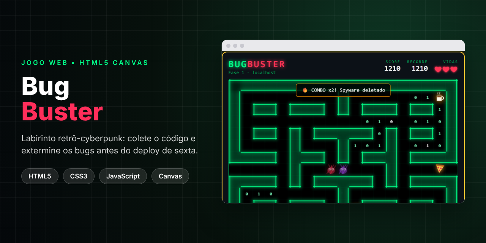
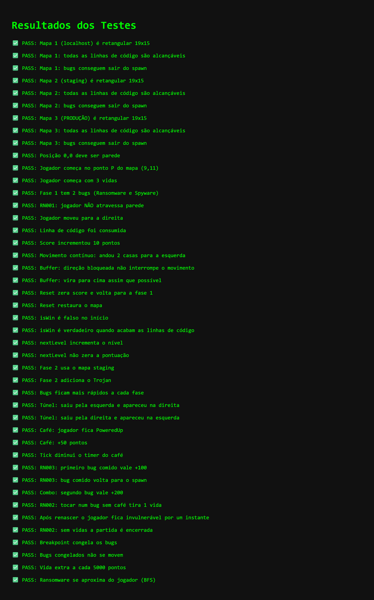

<p align="center">
  
</p>

<h1 align="center">🐛 Bug Buster</h1>

<p align="center">
  Jogo 2D de labirinto com estética <b>retrô-cyberpunk</b>: colete as linhas de código, tome café e extermine os
  bugs antes do deploy de sexta-feira. Feito só com <b>HTML5, CSS3 e JavaScript puro</b>, sem bibliotecas.
</p>

<p align="center">
  <a href="https://kauaxp77.github.io/BugBuster/"></a>
  
  
  
  
  
</p>

<p align="center">
  <a href="#-sobre-o-projeto">Sobre</a> •
  <a href="#-como-jogar">Como jogar</a> •
  <a href="#-funcionalidades">Funcionalidades</a> •
  <a href="#-telas">Telas</a> •
  <a href="#-como-executar">Como executar</a> •
  <a href="#-testes">Testes</a> •
  <a href="#-estrutura-do-projeto">Estrutura</a> •
  <a href="#-documentação-e-apresentação">Documentação</a>
</p>

---

## 📌 Sobre o projeto

O **Bug Buster** é um jogo de labirinto no estilo arcade em que você controla um programador que precisa coletar
todas as *linhas de código* (os bits `0` e `1`) do servidor enquanto foge dos bugs. Ele roda direto no navegador,
no computador e no celular, sem instalar nada.

Projeto desenvolvido para a disciplina de **Aplicações Front End — UniProjeção**.

### ▶ [Jogue online: kauaxp77.github.io/BugBuster](https://kauaxp77.github.io/BugBuster/)

Aponte a câmera do celular para o QR code:


## 🎮 Como jogar

- **Objetivo:** colete todas as *Linhas de Código* (os bits `0` e `1`) do servidor para avançar de fase.
- **Movimentação:** setas do teclado ou **WASD**. O programador anda sozinho na direção escolhida e a próxima curva
  fica "guardada" até ser possível virar. No celular, use o D-pad na tela ou deslize o dedo.
- **Vidas:** você começa com 3 ❤ e ganha uma vida extra a cada 5.000 pontos (máximo de 5).
- **Inimigos (bugs):**
  - 🔴 **Ransomware**: persegue você pelo caminho mais curto (BFS).
  - 🟣 **Spyware**: vaga aleatoriamente, mas às vezes resolve te seguir.
  - 🩷 **Trojan** (fase 2+): tenta chegar 4 casas **à frente** de você para te emboscar.
  - 🩵 **Worm** (fase 3+): patrulha e só te persegue quando você chega perto.
- **Itens:**
  - ☕ **Café**: invencibilidade temporária. Devore bugs com combo: 100 → 200 → 400 → 800 → 1600!
  - ⏸ **Breakpoint**: congela todos os bugs por 4 segundos.
  - 🍕 **Pizza da madrugada**: aparece por tempo limitado e vale +500.
- **Túneis:** saia pelas laterais do mapa para reaparecer do lado oposto.
- **Fases:** `localhost` → `staging` → `PRODUÇÃO` (sexta-feira, 17h59). A cada fase os bugs ficam mais rápidos e o
  café dura menos.
- **Atalhos:** `P`/`Esc` pausa, `M` liga/desliga o som, `Enter` confirma.
- 🤫 Tente o código Konami: `↑ ↑ ↓ ↓ ← → ← → B A`.

## ✨ Funcionalidades

| | Recurso | Descrição |
|---|---|---|
| 🕹️ | **3 fases** | `localhost`, `staging` e `PRODUÇÃO`, cada uma mais rápida e difícil |
| 🧠 | **IA dos bugs** | Quatro comportamentos: perseguição (BFS), andar aleatório, emboscada e patrulha |
| ☕ | **Power-ups** | Café com combo de pontos, Breakpoint que congela os bugs e pizza bônus |
| ❤️ | **Vidas e pontuação** | Vida extra a cada 5.000 pontos, até 5 vidas |
| 🏆 | **Top 5 recordes** | Ranking salvo no navegador com `localStorage` |
| 🔊 | **Som gerado por código** | Efeitos e trilha chiptune com a Web Audio API, sem arquivos de áudio |
| 🎨 | **Sprites por código** | Programador, bugs, café e pizza desenhados no Canvas |
| 📱 | **Celular** | D-pad na tela e controle por deslize |
| ⏸️ | **Pausa, vitória e game over** | Telas próprias para cada momento da partida |
| 🌈 | **Easter egg** | O código Konami liga o modo arco-íris |

## 🖼️ Telas

<table>
  <tr>
    <td align="center"><b>Menu inicial</b><br></td>
    <td align="center"><b>Café e combo</b><br></td>
  </tr>
  <tr>
    <td align="center"><b>Fase 3 — PRODUÇÃO</b><br></td>
    <td align="center"><b>Game over</b><br></td>
  </tr>
  <tr>
    <td align="center"><b>Celular</b><br></td>
    <td align="center"><b>Testes no navegador</b><br></td>
  </tr>
</table>

Mais capturas na pasta [`docs/telas/`](docs/telas/).

## 🚀 Como executar

Jogue direto em **https://kauaxp77.github.io/BugBuster/** (GitHub Pages).

Para rodar localmente, não precisa de servidor, Node.js nem bundler:

```bash
git clone https://github.com/kauaxp77/BugBuster.git
cd BugBuster
```

Depois, abra o arquivo `index.html` em qualquer navegador moderno.

## ✅ Testes

A lógica do jogo (`src/logic.js`) é separada da renderização e pode ser testada fora do navegador. O arquivo
`tests/test.js` faz **44 verificações**: mapas (formato, código alcançável, saída do spawn), movimento, coleta,
café e combo, perda de vidas, game over, Breakpoint, vida extra e a perseguição do Ransomware.

```bash
node tests/test.js
```

Ou abra `tests/test.html` no navegador para ver o resultado na tela.

## 📁 Estrutura do projeto

```
BugBuster/
├── index.html              # Canvas, HUD e telas de menu, pausa, vitória e game over
├── css/
│   └── style.css           # Estética de terminal neon e layout responsivo
├── src/
│   ├── logic.js            # Classe GameLogic: mapas, movimento, IA dos bugs, itens, vidas e pontuação
│   └── game.js             # Loop (requestAnimationFrame, 60 ticks/s), desenho, partículas, áudio e entrada
├── tests/
│   ├── test.js             # Testes da lógica (Node ou navegador)
│   └── test.html           # Página que roda os testes no navegador
└── docs/
    ├── banner.png
    ├── qrcode.png          # QR code para o jogo online
    ├── telas/              # Capturas de tela do jogo
    ├── Documentacao_BugBuster.pdf / .docx
    └── Apresentacao_BugBuster.pdf / .pptx
```

## 📄 Documentação e apresentação

- [Documentação do projeto (PDF)](docs/Documentacao_BugBuster.pdf) · [versão Word](docs/Documentacao_BugBuster.docx)
- [Apresentação final (PDF)](docs/Apresentacao_BugBuster.pdf) · [versão PowerPoint](docs/Apresentacao_BugBuster.pptx)

## 🛠️ Tecnologias

- **HTML5 Canvas**: renderização 2D a 60 FPS, com sprites desenhados por código
- **CSS3 (Flexbox/Grid)**: HUD, menus, animações (glitch, shake) e efeito neon
- **JavaScript (ES6)**: lógica (`logic.js`) separada da renderização e do loop (`game.js`)
- **Web Audio API**: efeitos sonoros e trilha chiptune gerados em tempo real
- **localStorage**: top 5 recordes salvos no navegador
- **GitHub Pages**: publicação do jogo

## 👨‍💻 Autor

Desenvolvido por **[kauaxp77](https://github.com/kauaxp77)** para a disciplina de Aplicações Front End — UniProjeção.

<p align="center">⭐ Se curtiu o projeto, deixe uma estrela!</p>
